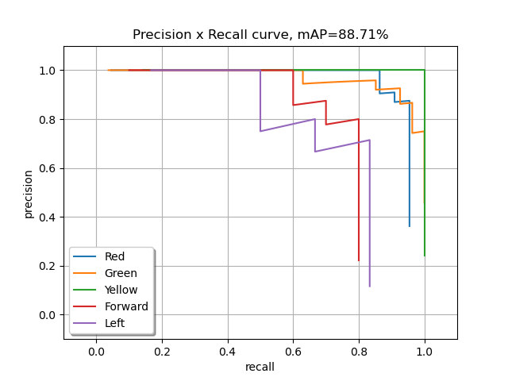
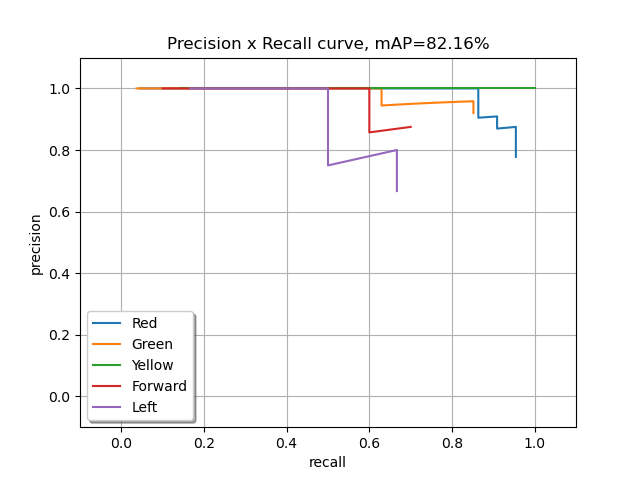

# 信号機検出
信号機を検出し、画面右下に認識結果を表示します。

## 使用した技術
- Pytorch
- Faster R-CNN

物体検出の代表的なモデルである Faster R-CNN を勉強したので、理解を深めるために実際に使用してみました。

## 実行例
YouTubeに1分程度のデモ動画をアップロードしています。 
https://youtu.be/RZgY4dEtYw8

 

# 学習
## 学習データ
学習データはYouTube動画をスクショして集めました。 
アノテーションはCVAT 1.1 フォーマットで作成しました。 
- Train: 420枚
- Test: 31枚

- ↓ データセットの分析結果です。（analyze_dataset.pyを使用） 
    
    

## 学習結果
epoch: 16でearly stoppingしました。

 

# モデルの評価
モデルの評価には以下のツールを使用しました。
https://github.com/rafaelpadilla/review_object_detection_metrics/tree/main

- **AP,mAPの結果です。**（IOUの閾値を0.5に設定） 
緑、黄、赤は良く検出できています。矢印は他に比べると劣りますが、低くはないと思います。

    

 

- **信頼度の閾値を0.7に設定した際のAP,mAPの結果です。**（IOUの閾値を0.5に設定） 
動画では閾値を0.7に設定しているので、これが実際の性能です。

    

 

# 認識
- 閾値0.7を超えるボックスのみを表示しています。
- 手前の信号機を読み取るために、ボックスの面積を計算して最大のものを採用しています。

    